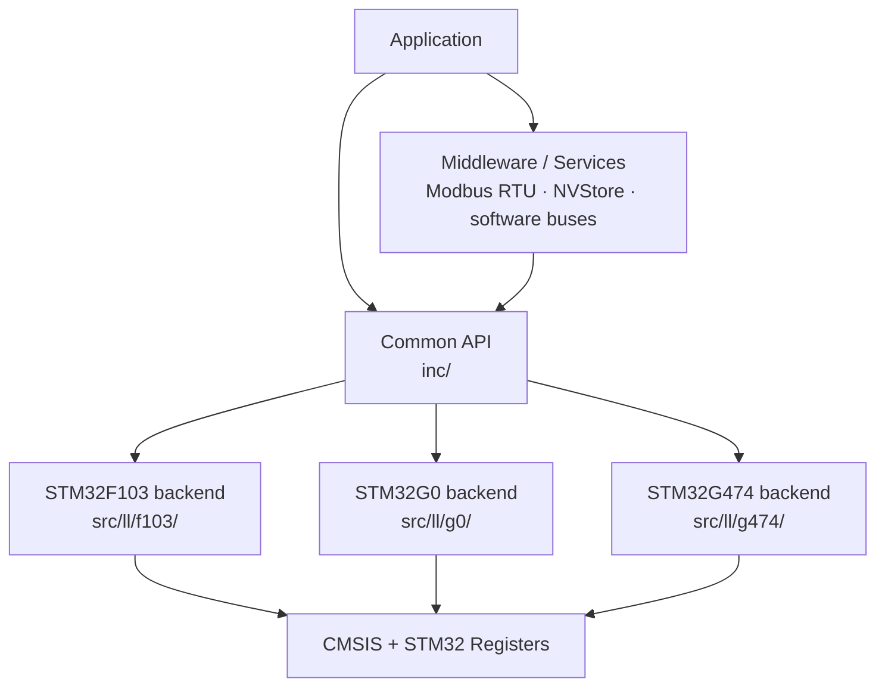

<table align="right">
  <tr>
    <td><b>🇬🇧 English</b></td>
    <td><a href="./README_RU.md">🇷🇺 Русский</a></td>
  </tr>
</table>

# ⚙️ HAL — Lightweight Register-Level STM32 Hardware Abstraction

A lightweight C hardware abstraction library for STM32 microcontrollers built directly on top of **CMSIS and peripheral registers**.

The library started as a small STM32F103 driver collection and gradually evolved into a multi-family abstraction layer used across robotics, measurement equipment and embedded control projects.

The goal is not to hide the MCU completely.

The goal is to remove repetitive hardware setup while keeping timing, resource allocation and important hardware behavior visible to the application.

> **Explicit where it matters, automatic where it is mechanical.**

---

## 🧠 Design Philosophy

The original STM32F103 implementation followed a very strict rule:

> Nothing should happen implicitly.

This was useful while learning the hardware, but it also produced unnecessary application-level boilerplate.

For example, using PWM could require separately configuring:

```text
timer clock
→ timer base
→ GPIO mode
→ alternate function
→ PWM channel
→ output enable
```

The newer G0/G4 architecture is more pragmatic.

The application specifies the information that actually matters:

```c
TIM_Init(TIM2, psc, arr, 0);
PWM_Init(PA0);
PWM_Write(PA0, value);
```

`PWM_Init()` internally performs the mechanical setup associated with that pin:

```text
pin
 ↓
timer/channel lookup
 ↓
timer clock enable
 ↓
GPIO alternate-function configuration
 ↓
PWM channel configuration
```

The timer frequency and resolution remain explicit because they affect application behavior.

---

## 🏗 Architecture



Public interfaces are placed in `inc/`, while MCU-specific register implementations are separated into family-specific backends.

This keeps application code relatively stable while allowing the low-level implementation to follow the actual peripheral architecture of each STM32 family.

---

## 🎯 MCU Support

| MCU | Status | Role |
|---|---|---|
| STM32F103 | ✅ Supported / Legacy | Original backend and older abstraction model |
| STM32G0B1 | ✅ Primary | Current architecture and main development target |
| STM32G474 | 🚧 In progress | Backend exists, target integration is not finished |

### STM32F103

The F103 backend is the oldest part of the library.

It remains usable and is still used by older projects, but several modules reflect the original, more manual abstraction philosophy.

It is intentionally treated as a **legacy backend** rather than the architectural reference for new development.

### STM32G0B1

STM32G0B1 is the current primary target.

This backend contains the newer initialization model, peripheral clock handling, alternate-function setup, error handling and newer services.

### STM32G474

A G474 backend already exists for most core peripherals, but integration is still incomplete.

It is currently considered **work in progress**, not a fully supported target.

---

## 🔌 Peripheral Support

| Peripheral / Service | F103 | G0B1 | G474 |
|---|:---:|:---:|:---:|
| GPIO | ✅ | ✅ | 🚧 |
| TIM / SysTick | ✅ | ✅ | 🚧 |
| PWM | ✅ | ✅ | 🚧 |
| ADC | ✅ | ✅ | 🚧 |
| DMA | ✅ | ✅ | 🚧 |
| USART | ✅ | ✅ | 🚧 |
| I²C | ✅ | ✅ | 🚧 |
| SPI | ✅ | ✅ | 🚧 |
| Flash LL | ✅ | ✅ | 🚧 |
| NVStore | ✅ | ✅ | 🚧 |
| DAC | — | ✅ | 🚧 |
| FDCAN / Classic CAN mode | — | ✅ | 🚧 |
| EXTI | ✅ | — | — |

`🚧` indicates that a backend implementation exists but the STM32G474 target is still under integration.

---

## 📍 GPIO

GPIO is represented by a small pin structure rather than board-specific Arduino-style pin numbers.

The implementation directly configures STM32 GPIO registers while exposing a common API:

```c
GPIO_PinMode(pin);
GPIO_PinModeMulti(pins, count);

GPIO_DigitalWrite(pin, 1);
GPIO_DigitalRead(pin);
GPIO_PinToggle(pin);
```

The actual configuration fields remain family-specific because STM32F1 GPIO configuration differs substantially from newer STM32 families.

---

## ⏱ Timers and PWM

The timer layer provides:

- general-purpose timer initialization;
- SysTick-based millisecond timebase;
- `millis()`;
- blocking millisecond delay;
- timer callback registration;
- runtime clock-frequency calculation.

PWM uses a pin-to-timer mapping table.

For example, on G0:

```c
TIM_Init(TIM2, 63, 999, 0);

PWM_Init(PA0);
PWM_Write(PA0, 500);
```

The caller explicitly controls the timer base.

`PWM_Init()` then automatically resolves:

```text
PA0
 ↓
TIM2
 ↓
Channel 1
 ↓
Alternate Function
```

and performs the required GPIO and timer-channel configuration.

---

## 📡 USART

USART implements interrupt-driven RX/TX with ring buffers.

```c
USART_Init(USART2, 115200, 0, 1);

USART_WriteLine(
    USART2,
    "System online\r\n",
    15
);

if (USART_Available(USART2)) {
    char byte = USART_ReadByte(USART2);
}
```

The driver handles:

- peripheral clock enable;
- TX/RX GPIO configuration;
- NVIC configuration;
- baud-rate register calculation;
- parity and stop-bit setup;
- interrupt-driven RX/TX;
- circular software buffers.

Custom RX and TX callbacks can also be attached through:

```c
USART_SetHandlers(...);
```

This mechanism is used by higher-level protocols such as Modbus RTU.

---

## 🔗 I²C

The G0 implementation includes more than basic register transactions.

Initialization performs:

```text
bus recovery
→ GPIO setup
→ peripheral clock/reset
→ timing configuration
→ peripheral enable
```

Before enabling the hardware controller, the driver can generate recovery clocks on SCL to release a slave holding the bus.

The transaction layer includes:

- register write;
- array write;
- single-register read;
- burst read;
- repeated START;
- timeout handling;
- NACK detection;
- bus error detection;
- arbitration-loss detection;
- overrun handling.

Example:

```c
I2C_Init(I2C1, SDA, SCL);

I2C_WriteReg(
    I2C1,
    device_address,
    register_address,
    value
);

I2C_Read_Burst(
    I2C1,
    device_address,
    start_register,
    buffer,
    sizeof(buffer)
);
```

The F103 implementation is older and simpler; the G0 backend represents the current design direction.

---

## 🔄 SPI

The SPI API separates a physical bus from devices connected to that bus.

```text
SPI_Handle_t
     ↓
SPI bus configuration

SPI_Device_t
     ↓
bus + chip-select
```

The API supports:

- SPI modes 0–3;
- configurable clock divider;
- MSB/LSB bit order;
- software chip select;
- generic transfers;
- read/write operations;
- register helpers for 8/16/24-bit data;
- big-endian and little-endian register access.

This allows several devices to share one SPI peripheral while maintaining independent CS configuration.

---

## 🚌 FDCAN

The STM32G0 backend provides a compact API for Classic CAN communication through the FDCAN peripheral:

```c
FDCAN_Init(FDCAN1, 500000u);

FDCAN_Send(
    FDCAN1,
    message_id,
    data,
    length
);

FDCAN_Read(
    FDCAN1,
    &message_id,
    data,
    &length
);
```

`FDCAN_Init()` internally handles:

- GPIO alternate-function setup;
- peripheral clock selection;
- FDCAN clock enable;
- bitrate calculation;
- nominal bit timing;
- Message RAM layout;
- RX/TX FIFO configuration;
- protocol initialization.

The current configuration uses:

- 16 time quanta per bit;
- 87.5% nominal sample point;
- standard 11-bit CAN identifiers;
- Classic CAN frames up to 8 bytes.

This driver is used by the distributed control architecture of the [Hexapod](https://github.com/suneids/Hexapod).

---

## 💾 Flash and NVStore

The library contains low-level internal Flash drivers together with a higher-level persistent storage service.

`NVStore` is designed for configuration data that must survive reset and unexpected power loss.

Its storage format uses:

```text
Header
  ├── magic
  ├── sequence number
  ├── version
  └── payload length

Payload

Tail
  ├── CRC32
  └── commit marker
```

The commit marker is written last.

Therefore an interrupted write does not automatically become a valid record after reboot.

The storage layer also provides:

- CRC32 validation;
- monotonically increasing sequence numbers;
- record scanning after startup;
- two-page storage;
- page rollover;
- payload versioning;
- detection of incomplete records.

Public API:

```c
NV_Init(&store);
NV_Load(&store, &config, sizeof(config));
NV_Save(&store, &config, sizeof(config));
```

---

## 📟 Modbus RTU

The repository also contains a Modbus RTU slave implementation built on top of the USART layer.

Currently implemented functions:

| Function | Operation |
|---|---|
| `0x03` | Read Holding Registers |
| `0x06` | Write Single Register |
| `0x10` | Write Multiple Registers |

The implementation includes:

- Modbus CRC16;
- register-range validation;
- exception responses;
- broadcast handling;
- configurable writable-register policy;
- application-level value validation callbacks;
- runtime UART configuration support;
- deferred persistent-storage update hooks.

This layer is used in measurement and industrial-interface projects.

---

## 🧩 Abstraction Boundary

The library deliberately does **not** attempt to make every STM32 peripheral look like a generic platform-independent device.

### Kept explicit

Things that materially affect system behavior remain visible:

- selected peripheral;
- timer frequency and resolution;
- baud rate;
- CAN bitrate;
- application buffers;
- protocol configuration;
- pin selection where routing matters.

### Handled internally

Mechanical setup is progressively moved into the driver:

- RCC peripheral clock enable;
- GPIO alternate-function setup;
- peripheral reset;
- pin-to-channel mapping;
- required NVIC setup;
- register initialization boilerplate.

This keeps the application close to the hardware without repeatedly reimplementing the same initialization sequence.

---

## 📁 Repository Structure

```text
HAL/
├── inc/
│   ├── adc.h
│   ├── dac.h
│   ├── dma.h
│   ├── fdcan.h
│   ├── flash_ll.h
│   ├── gpio.h
│   ├── i2c.h
│   ├── modbus.h
│   ├── nvstore.h
│   ├── pwm.h
│   ├── spi.h
│   ├── tim.h
│   └── usart.h
│
├── src/
│   ├── ll/
│   │   ├── f103/
│   │   ├── g0/
│   │   └── g474/
│   │
│   ├── modbus.c
│   ├── soft_i2c.c
│   └── utilities.c
│
├── ST/
│   ├── f103/
│   └── g0/
│
├── Midleware/
└── README.md
```

---

## 🔨 Used In

The library is not an isolated API experiment — it is used as infrastructure in larger projects:

- [🕷️ Hexapod](https://github.com/suneids/Hexapod) — distributed STM32 control and CAN;
- [🧤 Glove MK2](https://github.com/suneids/Glove) — ADC/DMA, I²C, USART, PWM;
- [🚗 RC Car MK2.5](https://github.com/suneids/Car) — PWM, USART and low-level control;
- industrial and measurement-device firmware using Modbus RTU and persistent configuration storage.

---

## 🚧 Current Direction

Current development focuses on:

- STM32G0 as the primary stable backend;
- gradual migration away from legacy F103-specific assumptions;
- completing STM32G474 integration;
- moving repetitive initialization into peripheral drivers;
- keeping hardware-critical parameters explicit at application level.

The library evolves together with the hardware projects that use it rather than attempting to reproduce the full STM32 vendor HAL.
