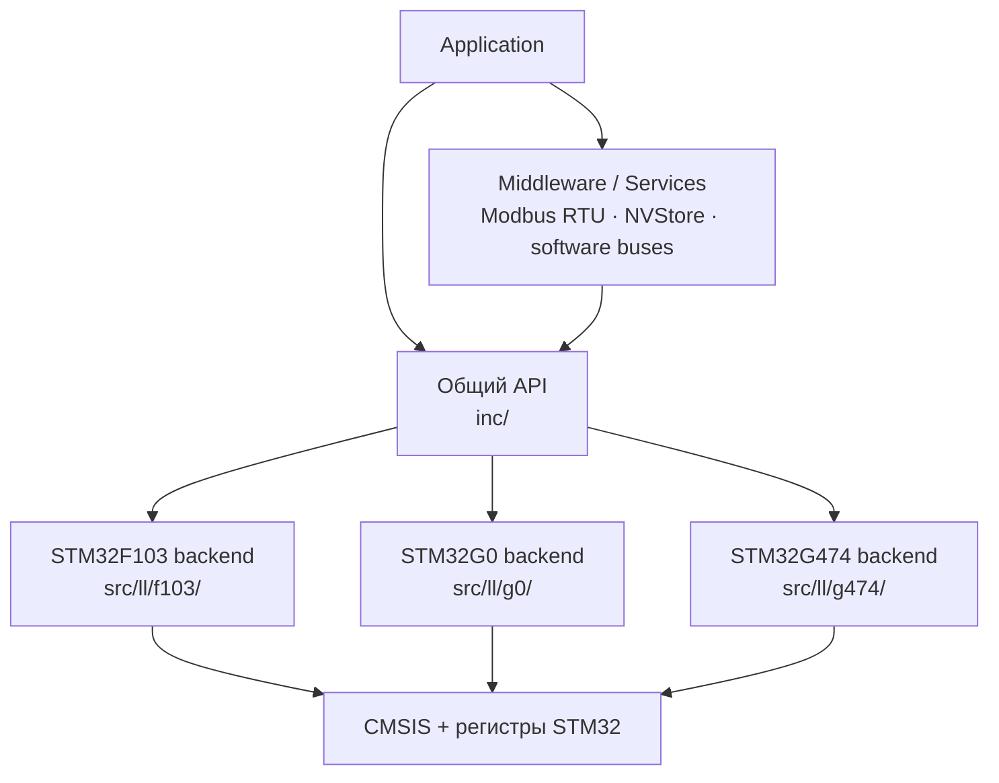

<table align="right">
  <tr>
    <td><a href="./README.md">🇬🇧 English</a></td>
    <td><b>🇷🇺 Русский</b></td>
  </tr>
</table>

# ⚙️ HAL — лёгкий register-level слой абстракции для STM32

Низкоуровневая библиотека на C для STM32, построенная непосредственно поверх **CMSIS и регистров периферии**.

Проект начинался как небольшой набор драйверов для STM32F103, а затем постепенно вырос в multi-family слой, используемый в робототехнике, измерительной электронике и embedded-системах управления.

Цель библиотеки — не полностью скрыть микроконтроллер.

Цель — убрать повторяющуюся аппаратную инициализацию, сохранив видимыми параметры, которые реально влияют на работу системы.

> **Явно там, где это важно; автоматически там, где это механическая работа.**

---

## 🧠 Философия

Первая реализация для STM32F103 строилась вокруг достаточно жёсткого принципа:

> Ничего не должно происходить неявно.

Для изучения железа это было полезно, но в прикладных проектах приводило к лишнему boilerplate-коду.

Например, использование PWM могло требовать отдельно настроить:

```text
clock таймера
→ базу таймера
→ GPIO
→ Alternate Function
→ канал PWM
→ разрешение выхода
```

В более новых G0/G4 backend подход стал практичнее.

Прикладной код указывает то, что действительно определяет поведение системы:

```c
TIM_Init(TIM2, psc, arr, 0);
PWM_Init(PA0);
PWM_Write(PA0, value);
```

А `PWM_Init()` самостоятельно выполняет механическую часть:

```text
pin
 ↓
поиск timer/channel
 ↓
включение clock таймера
 ↓
настройка GPIO Alternate Function
 ↓
настройка PWM-канала
```

При этом частота и разрешение таймера остаются явными, поскольку они непосредственно влияют на работу приложения.

---

## 🏗 Архитектура



Публичные интерфейсы находятся в `inc/`, а register-level реализации разделены по семействам STM32.

Это позволяет сохранять относительно стабильный прикладной API, при этом реализация каждого драйвера учитывает реальную архитектуру периферии конкретного семейства MCU.

---

## 🎯 Поддерживаемые MCU

| MCU | Состояние | Роль |
|---|---|---|
| STM32F103 | ✅ Supported / Legacy | Исходный backend со старой моделью абстракции |
| STM32G0B1 | ✅ Primary | Основная текущая архитектура |
| STM32G474 | 🚧 In progress | Backend существует, интеграция target ещё не закончена |

### STM32F103

F103 — самая старая часть библиотеки.

Backend остаётся рабочим и используется старыми проектами, однако часть модулей отражает первоначальный, более ручной подход к абстракции.

Поэтому он рассматривается как **legacy backend**, а не как архитектурный эталон для новых модулей.

### STM32G0B1

STM32G0B1 сейчас является основным target.

Здесь используется новая схема инициализации, автоматическая настройка периферийных clock, Alternate Function, обработка ошибок и более новые сервисы.

### STM32G474

Backend для G474 уже существует для большинства основных периферийных модулей, но target-интеграция ещё не завершена.

Поэтому сейчас это **in progress**, а не полностью поддерживаемая платформа.

---

## 🔌 Поддержка периферии

| Периферия / сервис | F103 | G0B1 | G474 |
|---|:---:|:---:|:---:|
| GPIO | ✅ | ✅ | 🚧 |
| TIM / SysTick | ✅ | ✅ | 🚧 |
| PWM | ✅ | ✅ | 🚧 |
| ADC | ✅ | ✅ | 🚧 |
| DMA | ✅ | ✅ | 🚧 |
| USART | ✅ | ✅ | 🚧 |
| I²C | ✅ | ✅ | 🚧 |
| SPI | ✅ | ✅ | 🚧 |
| Flash LL | ✅ | ✅ | 🚧 |
| NVStore | ✅ | ✅ | 🚧 |
| DAC | — | ✅ | 🚧 |
| FDCAN / Classic CAN mode | — | ✅ | 🚧 |
| EXTI | ✅ | — | — |

`🚧` означает, что реализация backend уже существует, но STM32G474 target пока находится в процессе интеграции.

---

## 📍 GPIO

GPIO представлен структурой пина, а не Arduino-подобным номером.

Библиотека непосредственно настраивает регистры STM32, предоставляя общий API:

```c
GPIO_PinMode(pin);
GPIO_PinModeMulti(pins, count);

GPIO_DigitalWrite(pin, 1);
GPIO_DigitalRead(pin);
GPIO_PinToggle(pin);
```

Поля конфигурации самого `GPIO_Pin_t` остаются family-specific, поскольку GPIO архитектура STM32F1 существенно отличается от более новых семейств STM32.

---

## ⏱ Таймеры и PWM

Timer layer предоставляет:

- инициализацию general-purpose timer;
- миллисекундную временную базу SysTick;
- `millis()`;
- блокирующую задержку;
- регистрацию callback для timer IRQ;
- расчёт текущих частот шин из RCC.

PWM использует таблицу соответствия pin → timer/channel.

Например для G0:

```c
TIM_Init(TIM2, 63, 999, 0);

PWM_Init(PA0);
PWM_Write(PA0, 500);
```

База таймера задаётся вызывающим кодом явно.

После этого `PWM_Init()` автоматически определяет:

```text
PA0
 ↓
TIM2
 ↓
Channel 1
 ↓
Alternate Function
```

и выполняет необходимую настройку GPIO и PWM-канала.

---

## 📡 USART

USART использует interrupt-driven RX/TX и кольцевые буферы.

```c
USART_Init(USART2, 115200, 0, 1);

USART_WriteLine(
    USART2,
    "System online\r\n",
    15
);

if (USART_Available(USART2)) {
    char byte = USART_ReadByte(USART2);
}
```

Драйвер самостоятельно выполняет:

- включение clock периферии;
- настройку GPIO TX/RX;
- настройку NVIC;
- расчёт BRR;
- настройку parity и stop bits;
- interrupt-driven приём и передачу;
- работу кольцевых программных буферов.

Также можно подключать собственные RX/TX callback:

```c
USART_SetHandlers(...);
```

Этот механизм используется более высокоуровневыми протоколами, например Modbus RTU.

---

## 🔗 I²C

G0-реализация уже включает не только базовые транзакции.

Инициализация выполняет:

```text
восстановление шины
→ настройка GPIO
→ clock/reset периферии
→ настройка timing
→ запуск I²C
```

Перед включением аппаратного контроллера драйвер может сформировать тактовые импульсы SCL для освобождения зависшего slave-устройства.

Transaction layer поддерживает:

- запись регистра;
- запись массива;
- чтение одного регистра;
- burst read;
- repeated START;
- timeout;
- обнаружение NACK;
- bus error;
- arbitration loss;
- overrun.

Пример:

```c
I2C_Init(I2C1, SDA, SCL);

I2C_WriteReg(
    I2C1,
    device_address,
    register_address,
    value
);

I2C_Read_Burst(
    I2C1,
    device_address,
    start_register,
    buffer,
    sizeof(buffer)
);
```

F103-реализация старше и проще; актуальное направление архитектуры лучше отражает G0 backend.

---

## 🔄 SPI

В SPI API разделены физическая шина и подключённые к ней устройства.

```text
SPI_Handle_t
     ↓
конфигурация SPI bus

SPI_Device_t
     ↓
bus + chip-select
```

Поддерживаются:

- SPI Mode 0–3;
- настраиваемый делитель частоты;
- MSB/LSB first;
- программный CS;
- универсальные transfer;
- read/write;
- helper-функции для 8/16/24-битных регистров;
- big-endian и little-endian access.

Таким образом несколько устройств могут использовать одну SPI-периферию, сохраняя независимую конфигурацию CS.

---

## 🚌 FDCAN

G0 backend предоставляет компактный API для Classic CAN поверх STM32 FDCAN:

```c
FDCAN_Init(FDCAN1, 500000u);

FDCAN_Send(
    FDCAN1,
    message_id,
    data,
    length
);

FDCAN_Read(
    FDCAN1,
    &message_id,
    data,
    &length
);
```

`FDCAN_Init()` самостоятельно выполняет:

- настройку GPIO Alternate Function;
- выбор clock периферии;
- включение FDCAN clock;
- расчёт bitrate;
- настройку nominal bit timing;
- разметку Message RAM;
- конфигурацию RX/TX FIFO;
- запуск контроллера.

Текущая конфигурация:

- 16 time quanta на бит;
- nominal sample point 87.5%;
- стандартные 11-битные CAN ID;
- Classic CAN frame до 8 байт.

Драйвер используется в распределённой архитектуре управления [Hexapod](https://github.com/suneids/Hexapod).

---

## 💾 Flash и NVStore

В библиотеке есть низкоуровневый Flash driver и отдельный высокоуровневый слой постоянного хранения конфигурации.

`NVStore` рассчитан на данные, которые должны переживать reset и неожиданный обрыв питания.

Формат записи:

```text
Header
  ├── magic
  ├── sequence number
  ├── version
  └── payload length

Payload

Tail
  ├── CRC32
  └── commit marker
```

Commit marker записывается последним.

Поэтому оборванная запись после следующего запуска не считается автоматически валидной.

Также реализованы:

- CRC32;
- sequence number;
- поиск последней валидной записи после старта;
- две Flash page;
- rollover между страницами;
- версия payload;
- обнаружение незавершённых записей.

Публичный API:

```c
NV_Init(&store);
NV_Load(&store, &config, sizeof(config));
NV_Save(&store, &config, sizeof(config));
```

---

## 📟 Modbus RTU

В репозитории находится Modbus RTU slave, построенный поверх USART layer.

Реализованы функции:

| Function | Операция |
|---|---|
| `0x03` | Read Holding Registers |
| `0x06` | Write Single Register |
| `0x10` | Write Multiple Registers |

Реализация включает:

- Modbus CRC16;
- проверку диапазона регистров;
- exception responses;
- broadcast;
- callback для определения writable-регистров;
- callback валидации новых значений;
- поддержку изменения UART configuration;
- механизм отложенного сохранения изменённой конфигурации.

Этот слой используется в измерительных и промышленных embedded-проектах.

---

## 🧩 Граница абстракции

Библиотека намеренно не пытается превратить всю периферию STM32 в полностью универсальные platform-independent объекты.

### Остаётся явным

То, что реально влияет на систему:

- выбор периферии;
- частота и разрешение таймера;
- baud rate;
- CAN bitrate;
- application buffers;
- конфигурация протоколов;
- выбор pin там, где он имеет значение.

### Выполняется автоматически

Повторяющаяся механическая настройка постепенно переносится внутрь драйверов:

- RCC clock enable;
- GPIO Alternate Function;
- peripheral reset;
- pin-to-channel mapping;
- необходимая настройка NVIC;
- типовой register initialization boilerplate.

В результате application code остаётся близким к реальному железу, но не повторяет одну и ту же последовательность инициализации в каждом проекте.

---

## 📁 Структура репозитория

```text
HAL/
├── inc/
│   ├── adc.h
│   ├── dac.h
│   ├── dma.h
│   ├── fdcan.h
│   ├── flash_ll.h
│   ├── gpio.h
│   ├── i2c.h
│   ├── modbus.h
│   ├── nvstore.h
│   ├── pwm.h
│   ├── spi.h
│   ├── tim.h
│   └── usart.h
│
├── src/
│   ├── ll/
│   │   ├── f103/
│   │   ├── g0/
│   │   └── g474/
│   │
│   ├── modbus.c
│   ├── soft_i2c.c
│   └── utilities.c
│
├── ST/
│   ├── f103/
│   └── g0/
│
├── Midleware/
└── README.md
```

---

## 🔨 Используется в проектах

Это не изолированный эксперимент с API — библиотека используется как инфраструктура в более крупных системах:

- [🕷️ Hexapod](https://github.com/suneids/Hexapod) — распределённое STM32-управление и CAN;
- [🧤 Glove MK2](https://github.com/suneids/Glove) — ADC/DMA, I²C, USART, PWM;
- [🚗 RC Car MK2.5](https://github.com/suneids/Car) — PWM, USART и низкоуровневое управление;
- измерительные и промышленные устройства с Modbus RTU и постоянным хранением конфигурации.

---

## 🚧 Текущее направление

Сейчас разработка ориентирована на:

- STM32G0 как основной стабильный backend;
- постепенное устранение legacy F103-specific решений;
- завершение интеграции STM32G474;
- перенос повторяющейся инициализации внутрь peripheral drivers;
- сохранение hardware-critical параметров явными на уровне application.

Библиотека развивается вместе с реальными устройствами, в которых используется, а не ставит целью полностью воспроизвести vendor HAL STM32.
